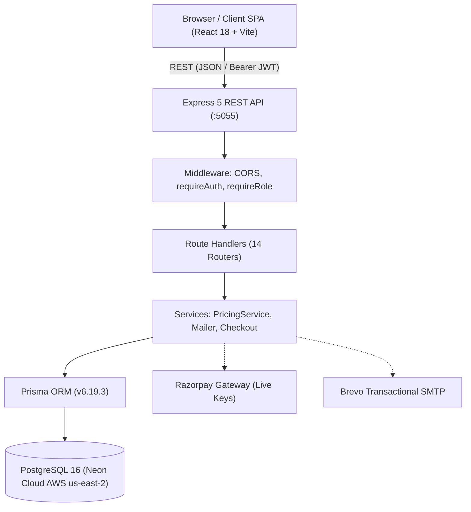

# 01 — PROJECT ARCHITECTURE AUDIT
**Project:** Guru Diamonds (Full-Stack Diamond & Luxury Jewellery eCommerce Platform)  
**Audit Date:** November 6, 2026  
**Auditor Role:** Principal Software Architect & Reliability Engineer  
**Status:** COMPLETE & EVIDENCE-BASED  

---

## 1. Executive Summary & Stack Overview

Guru Diamonds is architected as a decoupled, monolithic full-stack application with a client-rendered React Single Page Application (SPA) on Vite and an Express 5 TypeScript backend powered by Prisma ORM connected to a Neon PostgreSQL cloud database.

### Technology Matrix

| Layer | Technology | Version | Notes / Observations |
| :--- | :--- | :--- | :--- |
| **Frontend Framework** | React + React DOM | `^18.3.1` | Lazy-loaded code-splitting for all routes |
| **Bundler & Dev Server**| Vite | `^6.4.3` | Custom SPA history rewrites |
| **Styling** | Tailwind CSS + Lucide Icons | `v4.1.14` / `v0.546.0` | Custom luxury gold `#A67C32` theme palette |
| **State Management** | Zustand | `^5.0.3` | 10 dedicated stores with local persistence |
| **Animation & Charts** | Motion / Recharts | `^12.23.24` / `^2.15.1` | Dashboard metrics and interactive drawers |
| **Backend Framework** | Express | `^5.2.1` | Express 5 with native async error handling |
| **ORM / Data Layer** | Prisma Client | `^6.19.3` | Multi-table relational schema with JSON fields |
| **Database** | PostgreSQL | `v16` (Neon Serverless) | Connection pooling via AWS us-east-2 |
| **Payment Gateway** | Razorpay SDK | `^2.9.5` | Webhook verification + client checkout modal |
| **Email Service** | Brevo HTTP API (ex-Sendinblue)| Custom fetch | Transactional order & verification notifications |
| **Test Frameworks** | Vitest + Jest + Supertest | `v4.1.10` / `v29.7.0` | Dual test runners configured |

---

## 2. End-to-End Architectural Tracing

### End-to-End Request Pipeline
$$\text{User Action} \longrightarrow \text{Zustand Store} \longrightarrow \text{API Client (api.ts)} \longrightarrow \text{Express App} \longrightarrow \text{Auth/Role Middleware} \longrightarrow \text{Route Handler} \longrightarrow \text{Prisma ORM} \longrightarrow \text{Neon DB}$$

1. **Client Ingestion (`src/App.tsx`)**:
   - Navigation is handled through window popstate events using `navigateTo(path)` rather than `react-router-dom`.
   - On boot, six stores (`useAuthStore`, `useCategoryStore`, `useProductStore`, `useMetalRateStore`, `useCMSStore`, `useCartStore`) fire parallel hydration routines against backend endpoints.
2. **Transport Client (`src/services/api.ts`)**:
   - `apiRequest<T>` encapsulates browser `fetch`, auto-attaching `Authorization: Bearer <JWT>`.
   - Token lookup resolves against `guru_diamonds_auth_token_v1` with legacy migration from `vedaara_auth_token_v1`.
3. **Backend Middleware Chain (`backend/src/app.ts`)**:
   - Express 5 pipeline:
     1. `cors()` (Wide open to `*` by default).
     2. Static file handlers for `/products` and `/categories`.
     3. Raw body parser for `/api/payments/webhook/razorpay`.
     4. JSON body parser with limit set to `15mb`.
     5. 14 modular routers mounted under `/api`.
     6. Global 404 handler for unknown `/api/*` routes.
     7. Express error handling middleware returning `{ message: err.message }`.

---

## 3. Structural Deficiencies & Architectural Hazards

### 🔴 Critical Architecture Flaw 1: Base64 Media Storage in Database
* **Location:** [`src/pages/admin/AdminProductFormPage.tsx#L20-L50`](file:///c:/Users/Rakshitha/Downloads/Gurudiamonds/src/pages/admin/AdminProductFormPage.tsx#L20-L50)
* **Diagnosis:** Admin product image uploads are canvas-resized client-side and saved as **Base64 Data URLs** (`data:image/jpeg;base64,...`). When submitted, multi-megabyte image payload strings are written directly into `Product.images` (a Postgres `Json` column).
* **Impact:** No object storage (S3/Cloudinary/Blob) exists. Listing all products (`GET /api/products`) transfers megabytes of raw image data over the network, drastically degrading database performance, memory usage, and mobile page load times.

### 🔴 Critical Architecture Flaw 2: Port & Environment Mismatch
* **Location:** [`.env#L2-L3`](file:///c:/Users/Rakshitha/Downloads/Gurudiamonds/.env#L2-L3) vs [`src/services/api.ts#L1`](file:///c:/Users/Rakshitha/Downloads/Gurudiamonds/src/services/api.ts#L1) vs [`docs/DEPLOYMENT.md#L13`](file:///c:/Users/Rakshitha/Downloads/Gurudiamonds/docs/DEPLOYMENT.md#L13)
* **Diagnosis:** 
  - `.env` specifies: `PORT="5055"` and `VITE_API_URL="http://localhost:5055/api"`.
  - `src/services/api.ts` fallback specifies: `http://localhost:5000/api`.
  - `docs/DEPLOYMENT.md` specifies default `5000`.
* **Impact:** In environments where Vite is launched without preloading root `.env`, API calls silently target port 5000 while Express listens on 5055, leading to `ERR_CONNECTION_REFUSED` failures and fallback to stale mock data.

### 🔴 Critical Architecture Flaw 3: Brand & Domain Typo Discrepancies
* **Location:** [`.env#L1`](file:///c:/Users/Rakshitha/Downloads/Gurudiamonds/.env#L1), [`.env#L7`](file:///c:/Users/Rakshitha/Downloads/Gurudiamonds/.env#L7), and [`backend/src/config/env.ts#L14`](file:///c:/Users/Rakshitha/Downloads/Gurudiamonds/backend/src/config/env.ts#L14)
* **Diagnosis:** Three conflicting domain variations exist across code and config:
  1. `gurudimonds.in` (missing "a") — set in `APP_URL`.
  2. `gurudaimonds.in` ("a" before "i") — set in `FROM_EMAIL` and `backend/src/config/env.ts`.
  3. `gurudiamonds.in` (correct English spelling) — used in brand headings and copyright.
* **Impact:** Emails sent through Brevo using `info@gurudaimonds.in` will fail SPF, DKIM, and DMARC validations if DNS records are bound to `gurudimonds.in` or `gurudiamonds.in`, causing customer order confirmations to bounce or land in spam folders.

### 🟡 High Architectural Flaw 4: Dual Storage Split & Rebranding Vestiges
* **Location:** LocalStorage keys across `src/stores/`
* **Diagnosis:** Stores check and maintain fallback to legacy `vedaara_*` keys (`vedaara_orders_v1`, `vedaara_wishlist_ids`, `vedaara_cms_content_v1`).
* **Impact:** If users have residual legacy storage, old brand data takes precedence or triggers confusing migration paths.

