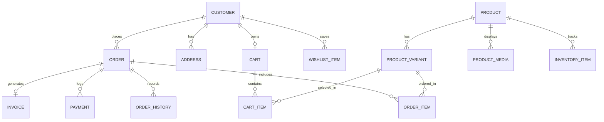

# 05 — DATABASE ARCHITECTURE & INTEGRITY AUDIT
**Project:** Guru Diamonds  
**Audit Date:** November 6, 2026  
**Auditor Role:** Database Reliability Engineer & Data Architect  
**Status:** COMPLETE & EVIDENCE-BASED  

---

## 1. Database Infrastructure & Configuration

| Parameter | Current Specification | Verification Result |
| :--- | :--- | :--- |
| **Engine** | PostgreSQL 16 (Serverless) | Verified (`tests/database/prisma.test.ts` passed in 7.4s) |
| **Hosting Provider** | Neon Cloud (`aws.neon.tech`, `us-east-2`) | SSL connection with channel binding enabled |
| **Connection Pooling** | PgBouncer Pooler (`ep-holy-sunset-ay1zaddi-pooler`) | Configured via `DATABASE_URL` |
| **ORM / Query Engine**| Prisma Client `v6.19.3` | Schema synchronized across 25 models |
| **Migration State** | 6 Applied Migrations (`prisma/migrations/`) | Clean migration ledger from Phase 2 through Phase 4 |

---

## 2. Relational Schema & Entity-Relationship Architecture



### Complete Model Inventory (25 Models)

1. **Catalog & Inventory:** `Category`, `JewelleryCollection`, `Product`, `ProductVariant`, `ProductMedia`, `InventoryItem`.
2. **Customer & Auth:** `Customer`, `Address`, `PendingRegistration`, `AdminUser`.
3. **Cart & Wishlist:** `Cart`, `CartItem`, `WishlistItem`.
4. **Orders & Commerce:** `Order`, `OrderItem`, `OrderHistory`, `Payment`, `Invoice`.
5. **Pricing & Operations:** `MetalRate`, `Coupon`, `CMSContent`, `EmailLog`, `GemstonePriceRule`, `CategoryPricingRule`, `PricingAuditLog`.

---

## 3. Data Integrity & Schema Hazards

### 🔴 Hazard 1: Unprotected Foreign Key on ProductVariant Deletion
* **Location:** `prisma/schema.prisma` lines 280-292
* **Schema Definition:**
  ```prisma
  model OrderItem {
    id        String          @id @default(cuid())
    orderId   String
    variantId String?
    variant   ProductVariant? @relation(fields: [variantId], references: [id])
  }
  ```
* **Integrity Bug:** Unlike `CartItem` (which defines `onDelete: SetNull`), `OrderItem.variant` has **NO `onDelete` directive**. 
* **Operational Failure:** When an admin edits a product in [`AdminProductFormPage.tsx`](file:///c:/Users/Rakshitha/Downloads/Gurudiamonds/src/pages/admin/AdminProductFormPage.tsx), the backend executes `variants: { deleteMany: {}, create: [...] }`. If any customer has previously purchased a variant of that product, PostgreSQL blocks the query with:
  `ERROR 23503: update or delete on table "ProductVariant" violates foreign key constraint "OrderItem_variantId_fkey"`
  and the entire product update fails with an internal server error (HTTP 500).
* **Remediation:** Add `onDelete: SetNull` or `onDelete: Restrict` to `OrderItem.variant`, or switch the catalog updater from `deleteMany` to incremental upserts.

### 🔴 Hazard 2: Heavy JSON Column Bloat (Base64 Media)
* **Location:** `Product.images` (`Json`) and `ProductVariant.images` (`Json`)
* **Integrity Issue:** Relational tables store raw `data:image/jpeg;base64,...` strings directly in JSONB/JSON columns.
* **Impact:** 
  - Table bloat slows down sequential scans and vacuuming on PostgreSQL.
  - JSON serialization overhead spikes CPU usage on both server and client.
  - No CDN caching or progressive streaming can occur.
* **Remediation:** Migrate image storage to an S3-compatible bucket or Cloudinary and store clean HTTPS URLs.

### 🟡 Hazard 3: Missing Soft Deletes
* **Location:** `Product`, `Category`, `Customer`, `Order`
* **Integrity Issue:** Deleting a product executes `prisma.product.delete({ where: { id } })`, permanently erasing the row and cascading to variants, media, and inventory items.
* **Remediation:** Implement soft deletion (`isDeleted Boolean @default(false)` or `deletedAt DateTime?`) to maintain accounting integrity.

### 🟡 Hazard 4: Completely Missing Inquiries Table
* **Location:** Database schema lacks any table for customer inquiries.
* **Impact:** All contact form submissions are lost from the database entirely.

---

## 4. Indexing & Query Performance Analysis

| Table | Indexed Columns | Performance Evaluation |
| :--- | :--- | :--- |
| `Product` | `[category]`, `[status]`, `[metalType, metalPurity]` | **Good:** Filtered catalog queries on `/shop` use composite index. |
| `ProductVariant` | `[productId]`, `[sku]` (unique) | **Good:** Instant lookup by SKU and product parent. |
| `Order` | `[customerId]`, `[orderStatus]`, `[placedAt]` | **Good:** Fast customer order filtering and chronological sorting. |
| `Payment` | `[orderId]`, `[providerOrderId]` | **Good:** Rapid webhook idempotency lookups. |
| `Customer` | `[email]` (unique) | **Warning:** Missing index on `phone` (Customer lookup by phone does a full table scan). |
| `AuditLog` | `[createdAt]` | **Good:** Fast timeline rendering. |

