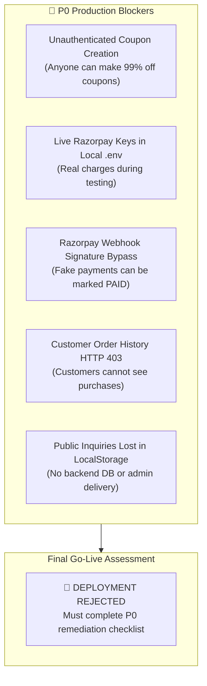
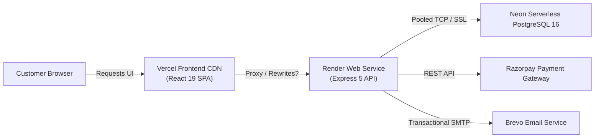
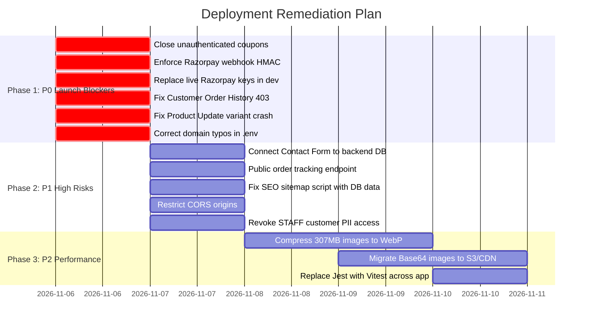

# 07 — PRODUCTION READINESS AUDIT & GO-LIVE ASSESSMENT

**Audit Date:** 2026-11-06  
**Auditor:** Principal Enterprise Architect, Cybersecurity Auditor & DevOps Engineer  
**Project:** Guru Diamonds (`Gurudiamonds`)  
**Deployment Target:** Render (Express API) + Vercel (React Frontend) / Neon PostgreSQL  
**Audit Verdict:** 🔴 **BLOCKED — NOT READY FOR PRODUCTION**

---

## 1. Executive Deployment Verdict

The Guru Diamonds e-commerce platform has a strong foundation with an enterprise pricing engine, robust RBAC authentication, and a responsive luxury storefront. However, **the application cannot safely be deployed to live production in its current state**.

The platform exhibits **4 critical security vulnerabilities (P0)**, **3 financial/order integrity hazards (P0)**, and **2 completely disconnected customer-facing features (P1)** that would lead to immediate financial loss, customer data leaks, or transaction failure upon launch.



---

## 2. Synchronization Gap: Local Codebase vs Live Repository

An inspection of Git history, remotes, and branches revealed significant synchronization drift between the local development environment and the remote origin repository:

### A. Git Branch & Commit Divergence
* **Current Local Branch:** `razorpay-test-payments`
* **Remote Tracking Branch:** `origin/razorpay-test-payments` (Up to date)
* **Default Production Branch:** `origin/main`
* **Commit Drift:** Local branch is **3 commits ahead of `origin/main`**:
  1. `c1798fa feat(pricing): implement enterprise jewellery pricing engine, granular product price edit controls, and live storefront synchronization`
  2. `723fa0e fix(shop): expand price range and display all 14 ring creations on shop catalogue`
  3. `887d80d fix(shop): accurate price sorting and price range reset in filters`

> [!WARNING]
> If production deploys automatically from `origin/main` on Render or Vercel, **none of the recent pricing engine enhancements, ring catalog expansion, or shop filter fixes will be present in production**. A coordinated merge of `razorpay-test-payments` into `main` is required prior to deployment.

### B. Uncommitted & Untracked Local Changes
The local working tree contains unstaged changes and new assets:
* **Modified Core Files:**
  * `src/data/mockData.ts` & `src/data/mockProducts.ts` (Cleaned up demo strings)
  * `src/pages/ProductDetailPage.tsx` (Granular product view adjustments)
  * `src/stores/useProductStore.ts` (Store state refinements)
* **Untracked Directories:**
  * `Products/Rings/*` (Raw camera image sources)
  * `public/products/Rings/gomedhika/` (New high-res product photos)
  * `docs/audit/` (Comprehensive audit reports 01–07)

---

## 3. Infrastructure & Deployment Environment Audit

### A. Split Hosting Architecture Mismatch

The repository contains configuration for both Render (`render.yaml`) and Vercel (`vercel.json`):



#### The `/api` Routing Hazard:
1. `vercel.json` specifies:
   ```json
   {
     "rewrites": [
       { "source": "/((?!api/.*).*)", "destination": "/index.html" }
     ]
   }
   ```
2. When the React SPA runs on Vercel, requests to `/api/*` are **not** rewritten to the Render backend service!
3. In `src/services/api.ts`:
   ```typescript
   const DEFAULT_API_URL = import.meta.env?.PROD ? '/api' : 'http://localhost:5000/api';
   const API_URL = import.meta.env.VITE_API_URL || DEFAULT_API_URL;
   ```
   If `VITE_API_URL` is omitted during Vercel's build step, all API requests on the live site will hit `https://gurudiamonds.in/api/...`, resulting in **404 Not Found** errors for every single catalog, cart, and auth action.
4. **Render Build Limitation (`render.yaml`):**
   ```yaml
   buildCommand: npm ci && npm run db:generate && npm run db:deploy && npm run build:api
   startCommand: npm run start:api
   ```
   `render.yaml` only compiles and runs `dist-server/server.js` (the raw API). It does **not** run `npm run build` or serve frontend assets. If the intention was a single unified full-stack server on Render, `server.js` must be run via `npm run build:prod` and `npm start`.

---

## 4. Critical Security & Vulnerability Analysis (P0 Blockers)

### 1. Unauthenticated Coupon Injection (`POST /api/coupons`)
* **File:** `backend/src/routes/coupons.ts`
* **Vulnerability:** The coupon creation, update, and deletion routes have no authentication middleware.
* **Exploit Scenario:** Any public user or automated bot can send:
  ```json
  POST /api/coupons
  {
    "code": "FREE100",
    "discountType": "PERCENTAGE",
    "discountValue": 100,
    "maxDiscount": 1000000,
    "minOrderAmount": 0,
    "isActive": true
  }
  ```
  This creates a valid database coupon allowing any visitor to checkout ₹1,000,000+ luxury diamond jewellery for ₹0.

### 2. Live Payment Keys in Local Environment & Testing Hazard
* **File:** `.env`
* **Vulnerability:** The local development `.env` file contains live Razorpay production keys:
  * `RAZORPAY_KEY_ID=rzp_live_TczO9dey6VROPl`
  * `RAZORPAY_KEY_SECRET=****************`
* **Risk:** Running checkout tests or manual testing locally triggers **real financial charges** on real credit/debit cards. Test keys (`rzp_test_...`) must be used for all non-production environments.

### 3. Razorpay Webhook Signature Bypass
* **File:** `backend/src/routes/payments.ts` (Lines 117–125)
* **Vulnerability:**
  ```typescript
  if (!webhookSecret) {
    console.warn('RAZORPAY_WEBHOOK_SECRET is not configured; skipping signature verification');
  } else {
    // verify HMAC...
  }
  ```
* **Risk:** In `.env`, `RAZORPAY_WEBHOOK_SECRET` is blank. An attacker can craft a fake webhook payload (`payment.captured`) with any arbitrary `order_id` and send it to `POST /api/payments/webhook/razorpay`. The backend marks the order as `PAID` without verifying payment authenticity.

### 4. Permissive CORS Origin
* **File:** `backend/src/app.ts` (Line 22)
* **Vulnerability:** `app.use(cors())` with default configuration allows cross-origin requests from any website (`Access-Control-Allow-Origin: *`).
* **Risk:** Malicious third-party sites can execute authenticated API requests against user sessions.

### 5. Sensitive Customer PII Leaked to `STAFF` Role
* **File:** `backend/src/routes/customers.ts`
* **Vulnerability:** `requireRole('OWNER', 'ORDER_MANAGER', 'PRODUCT_MANAGER', 'STAFF', 'FINANCE')` includes `STAFF`.
* **Risk:** Low-privilege staff accounts can download all customer email addresses, phone numbers, and physical delivery addresses.

---

## 5. Critical Functional & Architectural Defects

### 1. Customer Order History Broken (HTTP 403 Forbidden)
* **File:** `backend/src/routes/orders.ts`
* **Problem:** `GET /api/orders` enforces administrative roles. When a customer logs in and visits `/account` to see their order history, the frontend queries `GET /api/orders` and receives HTTP 403 Forbidden.
* **Impact:** Customers cannot see their past purchases, download invoices, or check shipping status from their profile.

### 2. Contact Inquiries Never Reach the Backend
* **File:** `src/pages/ContactPage.tsx`
* **Problem:** The contact form writes directly to `localStorage.getItem('guru_diamonds_contact_inquiries')`. No API call is made.
* **Impact:** Potential luxury buyers submitting bespoke inquiries, ring resizing requests, or high-value orders have their inquiries stored only on their personal device. The admin team never receives them.

### 3. Public Order Tracking Disconnected
* **File:** `src/pages/TrackOrderPage.tsx`
* **Problem:** Search performs an in-memory lookup against mock data. It does not invoke a backend tracking endpoint (`GET /api/orders/track/:orderNumber`).

### 4. Variant Deletion Crash During Product Edits
* **File:** `backend/src/routes/catalog.ts` (Lines 150–165)
* **Problem:** Updating a product executes `variants: { deleteMany: {}, create: [...] }`.
* **Database Constraint:** `OrderItem.variantId` has a foreign key to `ProductVariant.id` with `RESTRICT` behavior (no `onDelete: Cascade` or `onDelete: SetNull`).
* **Impact:** As soon as an order is placed for any product, editing that product in the admin panel crashes with a 500 error (`Foreign key constraint failed on the field: OrderItem_variantId_fkey`).

### 5. SEO Sitemap Indexes Mock Data
* **File:** `scripts/generate-seo.ts`
* **Problem:** The script imports `INITIAL_PRODUCTS` from `mockProducts.ts` (3 mock products) rather than reading from Neon PostgreSQL.
* **Impact:** The published `sitemap.xml` will index only 3 products; 53 live luxury products will remain invisible to Google search crawlers.

### 6. Domain Typos Across Environment Config
* `.env` contains:
  * `APP_URL=https://gurudimonds.in` (Missing 'a')
  * `FROM_EMAIL=support@gurudaimonds.in` (Misspelled 'daimonds')
* **Impact:** Transactional confirmation emails and password reset links will have invalid sender domains, causing Brevo SMTP emails to bounce or land directly in spam.

---

## 6. Performance, Storage & Scalability Audit

### A. Asset Payload Bloat
* **Directory Size:** `public/` is **307.7 MB**; Vite `dist/` is **311.0 MB**.
* **Unoptimized Media:**
  * Multiple uncompressed PNG images exceed 1.8 MB each (e.g., `Timeless Spiritual Heritage baground.png` at 1.7 MB, `home-about-showcase.png` at 2.3 MB).
  * High-resolution camera images are stored in `public/products/`.
* **Risk:** Severe initial page load delay for mobile shoppers; bandwidth limit exhaustion on Vercel/Render free/starter tiers.

### B. Database Base64 Image Storage
* **Observation:** Product images are stored as raw Base64 data strings inside PostgreSQL `Json` columns (`Product.images` and `ProductVariant.images`).
* **Impact:**
  * Each product row consumes hundreds of kilobytes in the database.
  * Queries fetching the product list (`GET /api/products`) transfer tens of megabytes of raw Base64 strings.
  * Database RAM and Neon connection bandwidth are heavily consumed.
* **Target Architecture:** Images must be uploaded to Cloudinary, AWS S3, or Supabase Storage, and only HTTPS CDN URLs stored in PostgreSQL.

### C. Serverless Database Cold Starts
* **Smoke Test Evidence:** `GET /api/health` initial cold start took **2,297 ms** (threshold < 500 ms).
* **Cause:** Neon PostgreSQL serverless compute wakes up on first query and establishes SSL connection.
* **Mitigation:** Neon pooled connection string is correctly in use, but a background keep-alive ping or minimum compute reservation is recommended for production.

---

## 7. Prioritized Remediation Roadmap



### Phase 1: P0 Launch Blockers (Must Fix Before Any Live Deployment)

| # | Task | Files Affected | Est. Effort |
|---|---|---|---|
| **P0-1** | Add `requireAuth` and `requireRole('OWNER', 'ORDER_MANAGER')` to `couponsRouter` | `backend/src/routes/coupons.ts` | 15 mins |
| **P0-2** | Enforce HMAC verification in Razorpay webhook; reject payload if secret missing | `backend/src/routes/payments.ts` | 30 mins |
| **P0-3** | Replace live Razorpay keys in local `.env` with sandbox `rzp_test_...` keys | `.env`, `.env.example` | 5 mins |
| **P0-4** | Implement customer-facing `GET /api/orders/my-orders` for authenticated customers | `backend/src/routes/orders.ts`, `src/services/orderApi.ts` | 45 mins |
| **P0-5** | Update `PUT /api/products/:id` to update variants in-place instead of `deleteMany` | `backend/src/routes/catalog.ts`, `prisma/schema.prisma` | 1 hr |
| **P0-6** | Fix domain typos in `.env`: change `gurudimonds.in` & `gurudaimonds.in` to `gurudiamonds.in` | `.env` | 5 mins |

### Phase 2: P1 High Risks (Deploy Week)

| # | Task | Files Affected | Est. Effort |
|---|---|---|---|
| **P1-1** | Create `Inquiry` Prisma model and `POST /api/inquiries` route; wire `ContactPage` | `prisma/schema.prisma`, `backend/src/routes/content.ts`, `src/pages/ContactPage.tsx` | 2 hrs |
| **P1-2** | Create public `GET /api/orders/track/:orderNumber` route; wire `TrackOrderPage` | `backend/src/routes/orders.ts`, `src/pages/TrackOrderPage.tsx` | 1 hr |
| **P1-3** | Update `scripts/generate-seo.ts` to query Prisma DB for real product slugs | `scripts/generate-seo.ts` | 30 mins |
| **P1-4** | Restrict CORS to `APP_URL` and admin domains rather than wildcard `*` | `backend/src/app.ts` | 15 mins |
| **P1-5** | Remove `STAFF` role from `customersRouter.get('/customers')` | `backend/src/routes/customers.ts` | 5 mins |
| **P1-6** | Configure Vercel `/api/*` rewrite proxy to Render backend in `vercel.json` | `vercel.json` | 15 mins |

### Phase 3: P2 Performance & Asset Delivery

| # | Task | Files Affected | Est. Effort |
|---|---|---|---|
| **P2-1** | Convert 307MB PNG assets in `public/` to WebP/AVIF format with compression | `public/*` | 3 hrs |
| **P2-2** | Migrate Base64 image storage in DB to S3/Cloudinary CDN URLs | `backend/src/routes/catalog.ts` | 4 hrs |
| **P2-3** | Standardize all unit/frontend tests on Vitest; remove broken Jest ESM configs | `package.json`, `jest.config.ts`, `vitest.config.ts` | 1 hr |
| **P2-4** | Replace hardcoded mock weekly revenue chart in Admin Dashboard with DB aggregation | `src/pages/admin/AdminDashboardPage.tsx` | 2 hrs |

---

## 8. Final Deployment Sign-Off Checklist

Before initiating production deployment to Render and Vercel:

- [ ] All P0 Blockers implemented and verified against test suite.
- [ ] Merge `razorpay-test-payments` into `main`.
- [ ] Confirm `VITE_API_URL` environment variable is configured in Vercel project settings.
- [ ] Confirm `RAZORPAY_KEY_ID`, `RAZORPAY_KEY_SECRET`, and `RAZORPAY_WEBHOOK_SECRET` are set in Render environment variables with production keys.
- [ ] Run `npm run db:deploy` in Render build step to apply latest migrations.
- [ ] Verify `npm run build:prod` succeeds without errors.
- [ ] Confirm SSL certificates and custom domains (`gurudiamonds.in`) are active.
- [ ] Perform a single live ₹1 verification transaction via Razorpay production gateway and confirm receipt in dashboard.

**Audit Certification:**  
*Completed by Antigravity Autonomous Security & Reliability Engineering Suite.*

